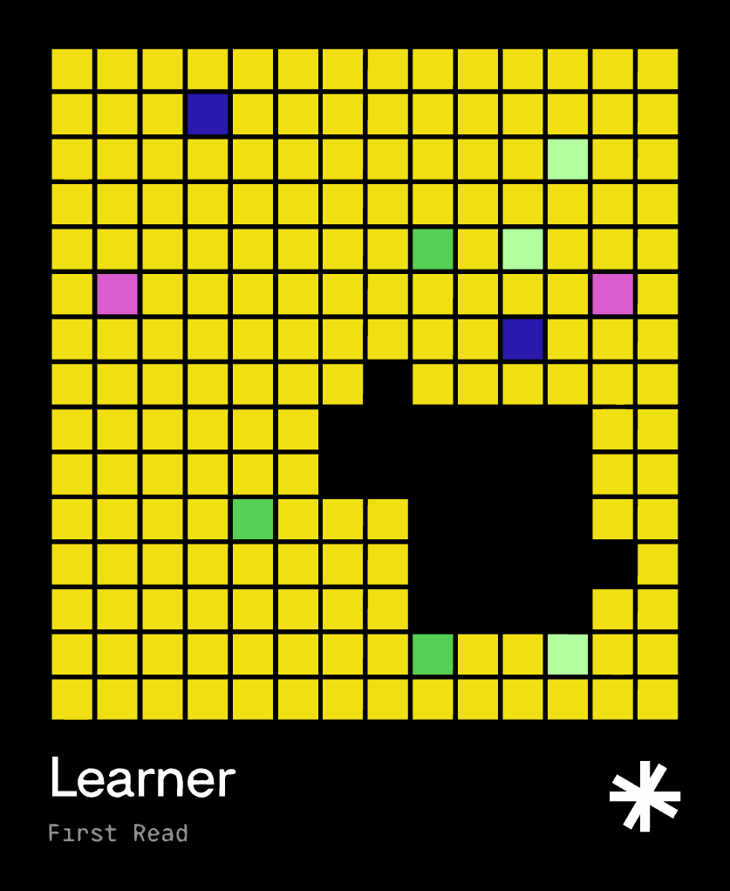
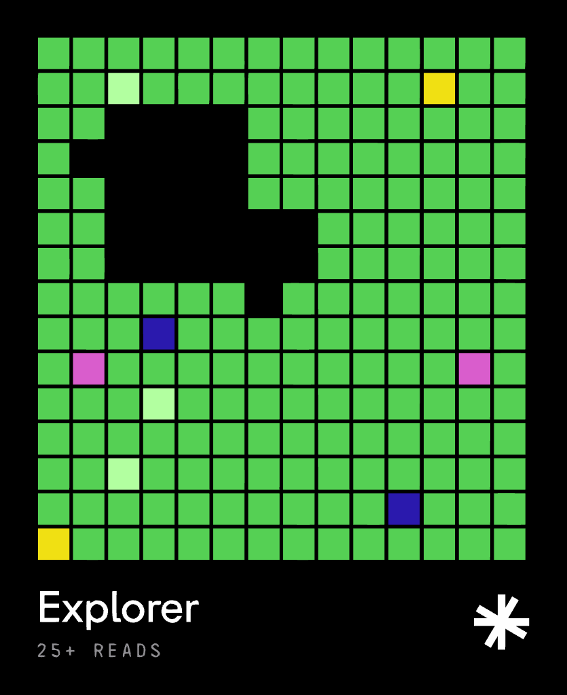
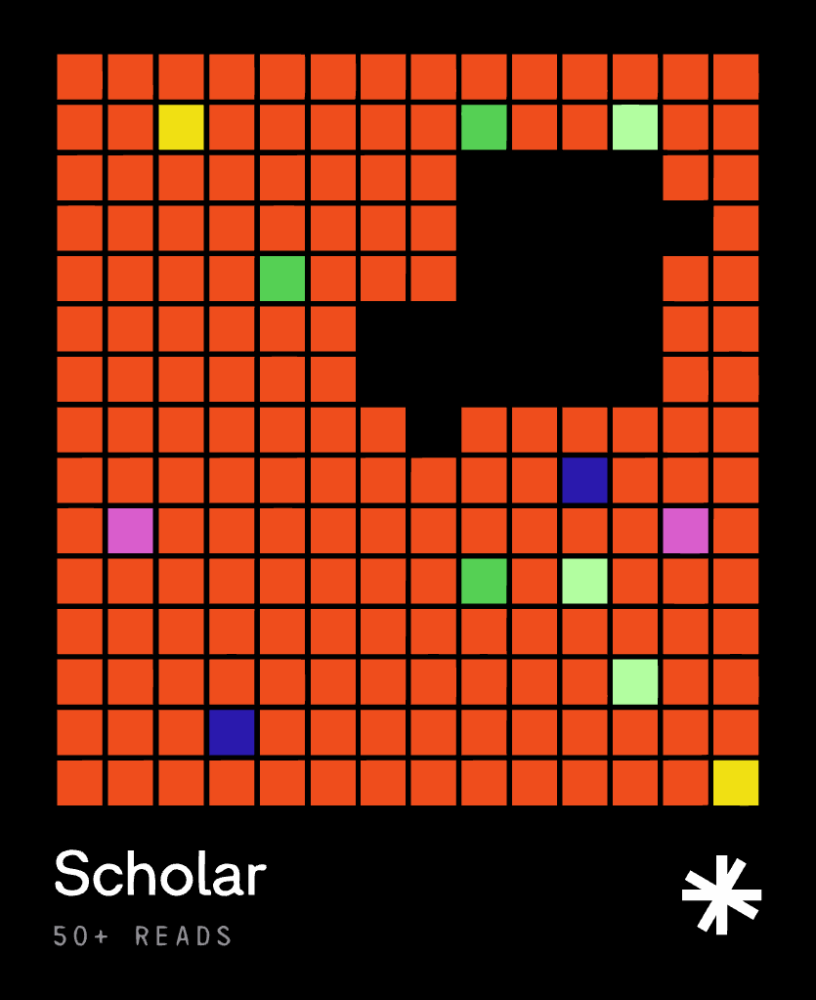
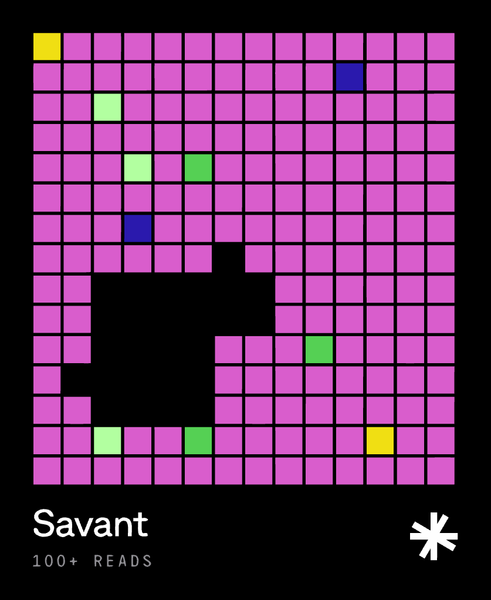

# @amirnaeem/artifact-card

Themeable React **award card** with a 3D glass shell and canvas-painted faces.

Built-in categories: **Reading** (Beginner→Oracle) and **Ninja** (AI Curious→AI Sensei). More tracks can be added with `defineCategory`. Flip the card, optionally flicker accent tiles, and pass `artSrc` / `markSrc` for custom art and mark.

Inspired by [Artifact](https://artifact.news/).

[](https://www.npmjs.com/package/@amirnaeem/artifact-card)
[](./LICENSE)
[](./package.json)
[](https://amirnaeem.github.io/artifact-card/)

**Demo:** [amirnaeem.github.io/artifact-card](https://amirnaeem.github.io/artifact-card/) · **npm:** [@amirnaeem/artifact-card](https://www.npmjs.com/package/@amirnaeem/artifact-card)

<p align="center">
  
  
  
  
  
  
  
  
</p>

---

## Install

```bash
npm install @amirnaeem/artifact-card three
```

| Peer | Range |
| --- | --- |
| `react` / `react-dom` | ^18 or ^19 |
| `three` | ^0.160 |

`react` and `react-dom` are assumed already in your app. Install `three` alongside this package.

---

## Use in your project

```tsx
import { LevelCard } from "@amirnaeem/artifact-card";
import "@amirnaeem/artifact-card/styles.css";

export function Profile() {
  return (
    <LevelCard
      level="Learner"
      fullName="Ada Lovelace"
      memberSince="2023"
    />
  );
}
```

1. Import the component.
2. Import `styles.css` once (app root or layout).
3. Pass a `level` (and optional `category`, identity, art/mark props).

Tap or click the card to flip. For controlled flip: `flipped` + `onFlip`.

Accent flicker is off by default (categories with `flicker: true`, e.g. Reading):

```tsx
<LevelCard category="reading" level="Savant" flicker fullName="Ada Lovelace" />
```

### Custom art & mark

```tsx
<LevelCard
  category="ninja"
  level="AI Ninja"
  artSrc="/hero.png"
  markSrc="/mark.svg"
  fullName="Ada Lovelace"
  memberSince="2023"
/>
```

- `artSrc` — enables an art face (mosaic tiles + panel). Art-face categories default to packaged art when omitted.
- `markSrc` — replaces the asterisk on front and back.
- `showMark={false}` — hides the **back** mark only.
- Custom `level` names work with `title` / `theme` / `artSrc` — behavior comes from category + resolved props.

### Vite

Works out of the box with the install above.

### Next.js (App Router)

```tsx
"use client";

import { LevelCard } from "@amirnaeem/artifact-card";
import "@amirnaeem/artifact-card/styles.css";

export function ProfileCard() {
  return <LevelCard level="Scholar" fullName="Ada Lovelace" memberSince="2023" />;
}
```

- Mark the consumer as a **Client Component** (`"use client"`).
- If the bundler fails to resolve the package, add it to `transpilePackages` in `next.config`:

```js
/** @type {import('next').NextConfig} */
const nextConfig = {
  transpilePackages: ["@amirnaeem/artifact-card"],
};

export default nextConfig;
```

Assets resolve from the package via `import.meta.url` — you do **not** copy files into `public/`.

---

## Props

| Prop | Type | Default | Description |
| --- | --- | --- | --- |
| `level` | `string` | — | Award level name (preset or custom) |
| `category` | `string` | inferred from `level` | Category id (`reading`, `ninja`, …) |
| `theme` | `Partial<LevelCardTheme>` | — | Deep-merged over the level preset |
| `title` | `string` | preset name | Front title |
| `caption` | `string` | preset caption | Front caption |
| `fullName` | `string` | — | Back identity (skipped when empty) |
| `memberSince` | `string` | — | Back meta (skipped when empty) |
| `brand` | `string` | `""` | Optional back brand line |
| `showMark` | `boolean` | `true` | Show back mark (asterisk or `markSrc`) |
| `artSrc` | `string` | category `defaultArtSrc` for art faces | Face art URL; enables art mosaic/panel when set |
| `markSrc` | `string` | — | Mark/logo URL (replaces asterisk on front + back) |
| `side` | `"front" \| "back"` | — | Flat single face |
| `mini` | `boolean` | `false` | Mosaic-only thumb |
| `flicker` | `boolean` | `false` | Animate accent tiles when the category allows flicker (not art faces); respects `prefers-reduced-motion` |
| `flipped` | `boolean` | — | Controlled flip |
| `defaultFlipped` | `boolean` | `false` | Uncontrolled initial flip |
| `onFlip` | `(flipped: boolean) => void` | — | Flip callback |
| `onNotify` | `(message: string) => void` | — | Tilt permission / errors |
| `className` | `string` | — | Wrapper class |
| `size` | `number` | `320` / `56` mini | Flat / mini CSS size (px) |

### Flat & mini

```tsx
<LevelCard level="Explorer" side="front" size={240} />
<LevelCard level="Explorer" side="back" fullName="Ada" memberSince="2023" />
<LevelCard level="Sage" mini size={56} />
```

---

## Categories

Each category is an ordered ladder plus defaults (`flicker`, `artFace`, `revealLadder`, `defaultArtSrc`). Reading and Ninja ship built-in; hosts can add more.

```tsx
import {
  LevelCard,
  listCategories,
  defineCategory,
  LEVEL_CARD_PRESETS,
} from "@amirnaeem/artifact-card";

function CategoryTabs() {
  return (
    <>
      {listCategories().map((cat) => (
        <button key={cat.id} type="button">
          {cat.label}
        </button>
      ))}
      <LevelCard category="ninja" level="AI Ninja" fullName="Ada Lovelace" />
    </>
  );
}

// Later: register another track, then add matching LEVEL_CARD_PRESETS entries
defineCategory({
  id: "guild",
  label: "Guild",
  order: ["Novice", "Member", "Elder"],
  flicker: true,
});
```

Pass `level` alone (category is inferred) or set `category` explicitly.

### Reading

Color mosaic. Chromatic levels support `flicker`.

| Level | Caption |
| --- | --- |
| `Beginner` | Just Joined |
| `Learner` | First Read |
| `Seeker` | 10+ reads |
| `Explorer` | 25+ reads |
| `Scholar` | 50+ reads |
| `Savant` | 100+ reads |
| `Sage` | 250+ reads |
| `Oracle` | 350+ reads |

### Ninja

Art face: mosaic tiles over a panel; gaps fill in as ranks rise (animated within the ladder).

| Level | Caption |
| --- | --- |
| `AI Curious` | 0 – 19 XP |
| `Apprentice` | 20 – 99 XP |
| `AI Ninja` | 100 – 299 XP |
| `Sensei Candidate` | 300+ XP — eval pending |
| `AI Sensei` | 300+ XP + evaluation |

---

## Theming

```tsx
<LevelCard
  level="Scholar"
  theme={{ primary: "#ff6600" }}
  fullName="Ada Lovelace"
  memberSince="2023"
  brand="ARTIFACT"
/>
```

Merge order: `defaultTheme` ← level preset ← `theme` prop.  
Arrays (`accents`, `voidCells`, …) replace wholesale.

### Fonts

| Variable | Role |
| --- | --- |
| `--font-head` | Front title |
| `--font-display` | Back name |
| `--font-sans` | Back brand |
| `--font-mono` | Caption / meta |

Set them on `:root` (or a host wrapper) to match your product fonts.

---

## Exports

| Export | Purpose |
| --- | --- |
| `LevelCard` | Main component |
| `LevelCardFace` / `LevelCardBack` | Standalone faces |
| `resolveCard` / `mergeTheme` / `defaultTheme` | Theme resolution |
| `LEVEL_CARD_PRESETS` / `LEVEL_CARD_ORDER` / `NINJA_CARD_ORDER` / `getPreset` | Presets |
| `CARD_CATEGORIES` / `listCategories` / `getCategory` / `categoryForLevel` / `defineCategory` | Categories |
| `paintFace` / `paintFaceMosaic` / `paintFaceChrome` / `paintBack` / `buildFaceModel` / `compositeFace` | Advanced paint |
| `CARD_GLTF_URL` | Packaged shell URL |
| `NINJA_ART_URL` | Default art for art-face categories when `artSrc` is omitted |
| Types | `LevelCardProps`, `LevelCardTheme`, `LevelCardPreset`, `CardCategory`, `CardCategoryId`, `LevelCardName`, … |

---

## Develop this repo

```bash
git clone https://github.com/amirnaeem/artifact-card.git
cd artifact-card
npm install
```

| Command | Description |
| --- | --- |
| `npm run dev` | Demo at [http://localhost:5173](http://localhost:5173) |
| `npm run check` | Typecheck + paint/grid/security self-checks |
| `npm run typecheck` | Typecheck only |
| `npm run build` | Emit library `dist/` |
| `npm run build:demo` | Build demo for GitHub Pages |

PRs go to `main` (CI must pass). `prepublishOnly` runs `check` then `build` before publish.

See [CONTRIBUTING.md](./CONTRIBUTING.md) · [SECURITY.md](./SECURITY.md)

---

## License

[MIT](./LICENSE) © Amir Naeem
