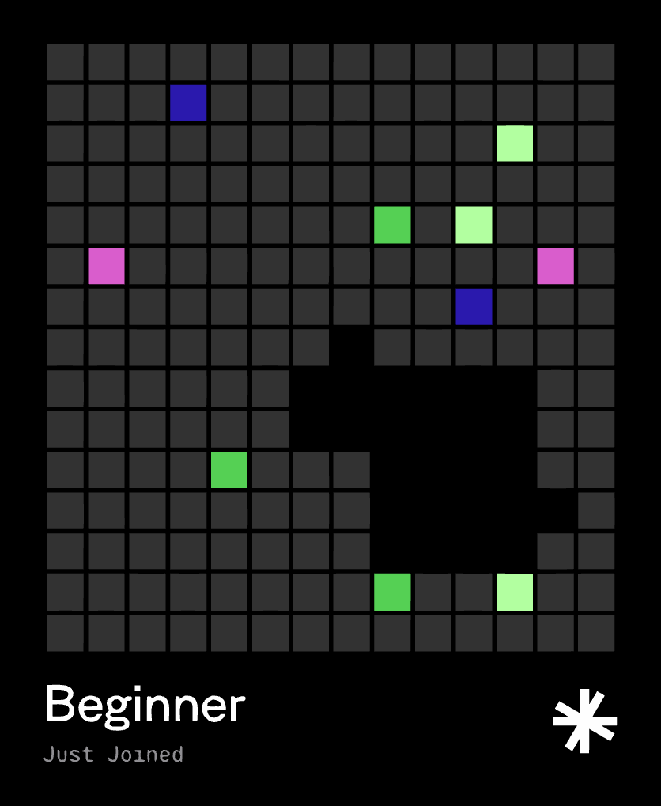
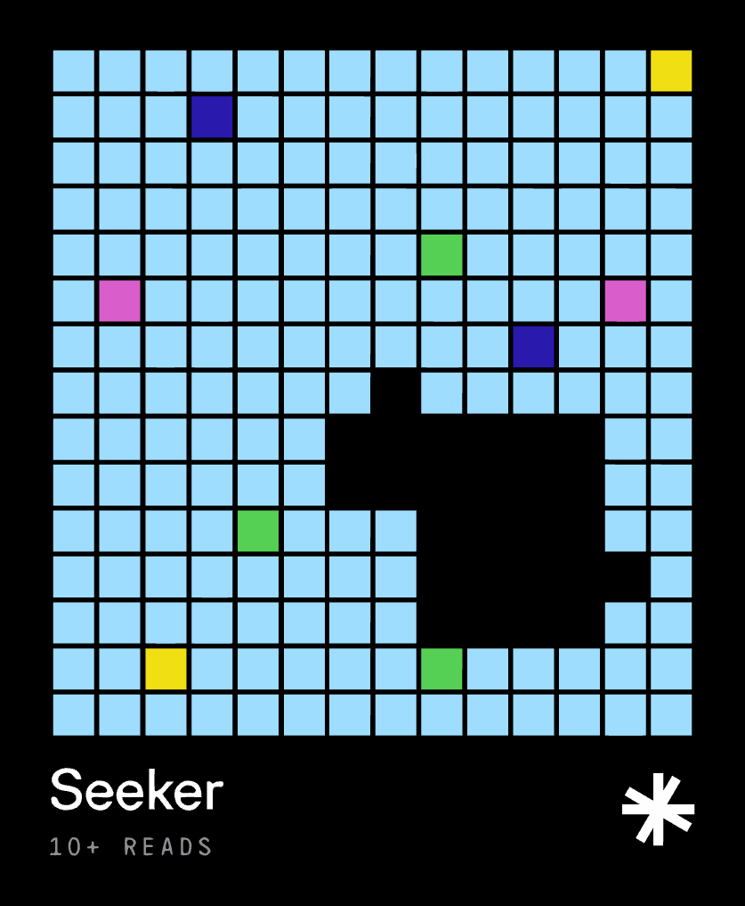
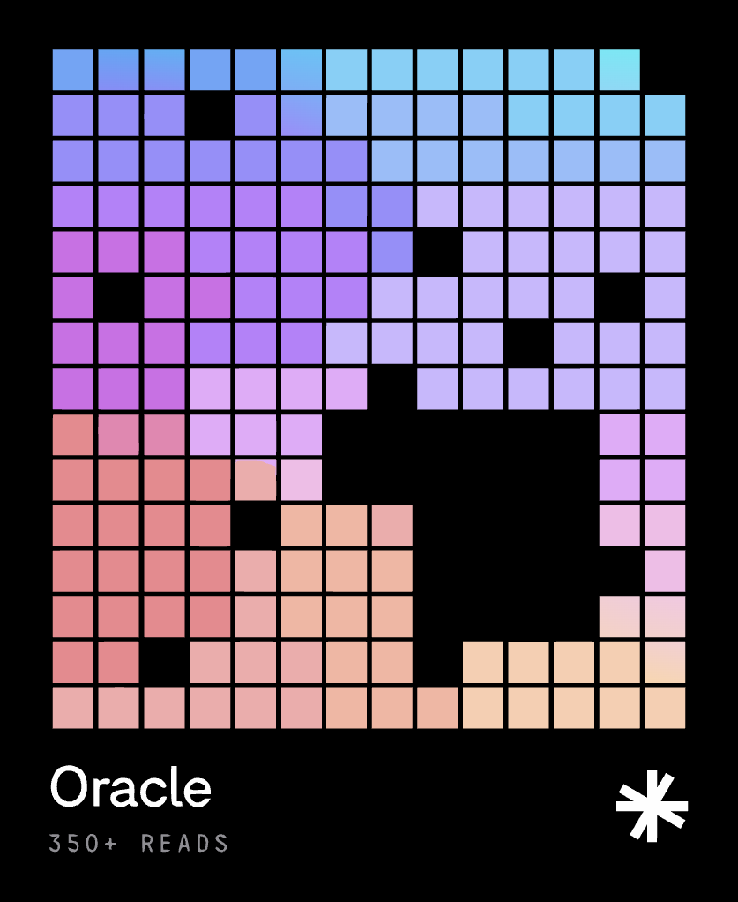

# @amirnaeem/artifact-card

Themeable React **award level card** — 3D glass shell, canvas-painted faces, host-defined categories.

Use the built-in **Reading** and **Ninja** packs, or register your own ladder with `defineCategory`.

Inspired by [Artifact](https://artifact.news/).

[](https://www.npmjs.com/package/@amirnaeem/artifact-card)
[](./LICENSE)
[](https://amirnaeem.github.io/artifact-card/)

**Demo:** [amirnaeem.github.io/artifact-card](https://amirnaeem.github.io/artifact-card/) · **npm:** [@amirnaeem/artifact-card](https://www.npmjs.com/package/@amirnaeem/artifact-card)

<p align="center">
  
  
  
  
  
  
  
  
</p>

---

## Install

```bash
npm install @amirnaeem/artifact-card three
```

| Peer | Range |
| --- | --- |
| `react` / `react-dom` | ^18 or ^19 |
| `three` | ^0.160 |

---

## Quick start

```tsx
import { LevelCard } from "@amirnaeem/artifact-card";
import "@amirnaeem/artifact-card/styles.css";

export function Profile() {
  return (
    <LevelCard
      level="Learner"
      fullName="Ada Lovelace"
      memberSince="2023"
    />
  );
}
```

1. Import `LevelCard`.
2. Import `styles.css` once (app root or layout).
3. Pass a `level` — category is inferred when omitted.

Tap the card to flip. Controlled flip: `flipped` + `onFlip`.

### Next.js (App Router)

```tsx
"use client";

import { LevelCard } from "@amirnaeem/artifact-card";
import "@amirnaeem/artifact-card/styles.css";

export function ProfileCard() {
  return <LevelCard level="Scholar" fullName="Ada Lovelace" memberSince="2023" />;
}
```

Add to `next.config` if the bundler cannot resolve the package:

```js
/** @type {import('next').NextConfig} */
export default {
  transpilePackages: ["@amirnaeem/artifact-card"],
};
```

Assets ship inside the package — you do not copy files into `public/`.

---

## Built-in categories

| Id | Style | Levels |
| --- | --- | --- |
| `reading` | Color mosaic | Beginner → Learner → Seeker → Explorer → Scholar → Savant → Sage → Oracle |
| `ninja` | Art face + progressive reveal | AI Curious → Apprentice → AI Ninja → Sensei Candidate → AI Sensei |

```tsx
<LevelCard category="reading" level="Savant" fullName="Ada Lovelace" />
<LevelCard category="ninja" level="AI Ninja" fullName="Ada Lovelace" />
```

Pass `level` alone and the category is inferred from the first matching pack. An explicit `category` wins even if that level is not in its `order`.

### Reading captions

| Level | Caption |
| --- | --- |
| Beginner | Just Joined |
| Learner | First Read |
| Seeker | 10+ reads |
| Explorer | 25+ reads |
| Scholar | 50+ reads |
| Savant | 100+ reads |
| Sage | 250+ reads |
| Oracle | 350+ reads |

### Ninja captions

| Level | Caption |
| --- | --- |
| AI Curious | 0 – 19 XP |
| Apprentice | 20 – 99 XP |
| AI Ninja | 100 – 299 XP |
| Sensei Candidate | 300+ XP — eval pending |
| AI Sensei | 300+ XP + evaluation |

Ninja ranks animate mosaic fill-in within the same ladder. Switching Reading ↔ Ninja hard-cuts (no cross-ladder tween).

---

## Bring your own category

Register a track once at app startup. Every name in `order` needs a preset (inline `presets` or prior `definePresets`).

```tsx
import {
  LevelCard,
  defineCategory,
  listCategories,
} from "@amirnaeem/artifact-card";

defineCategory({
  id: "guild",
  label: "Guild",
  order: ["Novice", "Member", "Elder"],
  presets: {
    Novice: {
      name: "Novice",
      caption: "Just joined",
      theme: { primary: "#323232", accents: ["#2A19AD"] },
    },
    Member: {
      name: "Member",
      caption: "Active",
      theme: { primary: "#F0E013", accents: ["#2A19AD"] },
    },
    Elder: {
      name: "Elder",
      caption: "Veteran",
      theme: { primary: "#D95DCC", accents: ["#55D054"] },
    },
  },
});

export function GuildCard() {
  return (
    <>
      {listCategories().map((cat) => (
        <span key={cat.id}>{cat.label}</span>
      ))}
      <LevelCard category="guild" level="Member" fullName="Ada Lovelace" />
    </>
  );
}
```

**Rules**

- `order` must be non-empty with unique names.
- Level names cannot overlap another category (unless you replace the same `id`).
- Replacing `"reading"` / `"ninja"` is allowed — that overrides the built-in pack.
- Art-face packs should set `artFace: true`, `defaultArtSrc`, and usually `revealLadder`. Without a usable art URL the card falls back to a color mosaic.
- One-off overrides without mutating the global registry:

```tsx
<LevelCard
  category="guild"
  level="Member"
  presets={{
    Member: {
      name: "Member",
      caption: "Scoped override",
      theme: { primary: "#00aa88" },
    },
  }}
/>
```

Related helpers: `definePreset`, `definePresets`, `undefineCategory`, `undefinePresets`, `getCategory`, `categoryForLevel`.

---

## Art & mark

```tsx
<LevelCard
  category="ninja"
  level="AI Ninja"
  artSrc="/hero.png"
  markSrc="/mark.svg"
  fullName="Ada Lovelace"
  memberSince="2023"
/>
```

| Prop | Behavior |
| --- | --- |
| `artSrc` | Enables art face (mosaic + panel). Art-face categories use `defaultArtSrc` when omitted. |
| `markSrc` | Replaces the asterisk on front and back. |
| `showMark={false}` | Hides the **back** mark only; front still draws mark/logo. |

Host `artSrc` must be a safe URL (`http(s)`, `blob`, `data:image`, or a relative path). Unsafe schemes fall through to `defaultArtSrc` or a color mosaic.

Custom levels work with `title` / `theme` / `artSrc` — no preset required if you pass everything you need.

---

## Props

| Prop | Type | Default | Description |
| --- | --- | --- | --- |
| `level` | `string` | — | Award level name |
| `category` | `string` | inferred | Category id (`reading`, `ninja`, …) |
| `presets` | `Record<string, LevelCardPreset>` | — | Scoped preset map for this card only |
| `theme` | `Partial<LevelCardTheme>` | — | Deep-merged over the level preset |
| `title` | `string` | preset / `level` / `"Award"` | Front title |
| `caption` | `string` | preset caption | Front caption |
| `fullName` | `string` | — | Back identity (skipped when empty) |
| `memberSince` | `string` | — | Back meta (skipped when empty) |
| `brand` | `string` | `""` | Optional back brand line |
| `showMark` | `boolean` | `true` | Show back mark |
| `artSrc` | `string` | category `defaultArtSrc` | Face art URL |
| `markSrc` | `string` | — | Mark/logo URL |
| `side` | `"front" \| "back"` | — | Flat single face (no GL shell) |
| `mini` | `boolean` | `false` | Mosaic-only thumb |
| `flipped` | `boolean` | — | Controlled flip |
| `defaultFlipped` | `boolean` | `false` | Uncontrolled initial flip |
| `onFlip` | `(flipped: boolean) => void` | — | Flip callback |
| `onNotify` | `(message: string) => void` | — | Tilt permission / errors |
| `className` | `string` | — | Wrapper class |
| `size` | `number` | `320` / `56` mini | Flat / mini CSS size (px) |

### Flat & mini

```tsx
<LevelCard level="Explorer" side="front" size={240} />
<LevelCard level="Explorer" side="back" fullName="Ada" memberSince="2023" />
<LevelCard level="Sage" mini size={56} />
```

For custom lab UIs, resolve once and paint:

```tsx
import { resolveCard, LevelCardFace, LevelCardBack } from "@amirnaeem/artifact-card";

const resolved = resolveCard({ level: "Learner", fullName: "Ada" });
<LevelCardFace resolved={resolved} level="Learner" size={200} />
<LevelCardBack resolved={resolved} size={200} />
```

---

## Theming

```tsx
<LevelCard
  level="Scholar"
  theme={{ primary: "#ff6600" }}
  fullName="Ada Lovelace"
  memberSince="2023"
  brand="ARTIFACT"
/>
```

Merge order: `defaultTheme` ← level preset ← `theme` prop.  
Arrays (`accents`, `voidCells`, …) replace wholesale.

| CSS variable | Role |
| --- | --- |
| `--font-head` | Front title |
| `--font-display` | Back name |
| `--font-sans` | Back brand |
| `--font-mono` | Caption / meta |

Set them on `:root` (or a host wrapper) to match your product fonts.

---

## API surface

| Export | Purpose |
| --- | --- |
| `LevelCard` | Main component (GL shell by default) |
| `LevelCardFace` / `LevelCardBack` | Flat faces from a `ResolvedCard` |
| `resolveCard` / `ResolvedCard` | Prop → render model |
| `defaultTheme` / `mergeTheme` | Theme helpers |
| `LEVEL_CARD_PRESETS` / `getPreset` | Global presets |
| `definePreset` / `definePresets` / `undefinePresets` | Register presets |
| `CARD_CATEGORIES` / `listCategories` / `getCategory` / `categoryForLevel` | Categories |
| `defineCategory` / `undefineCategory` | Register categories |
| `LEVEL_CARD_ORDER` / `NINJA_CARD_ORDER` | Built-in ladders |
| `CARD_GLTF_URL` / `NINJA_ART_URL` | Packaged asset URLs |
| `paintFace*` / `paintBack` / `buildFaceModel` / `compositeFace` | Advanced canvas paint |
| Types | `LevelCardProps`, `LevelCardTheme`, `LevelCardPreset`, `CardCategory`, `DefineCategoryInput`, … |

`LevelCardGl` is internal and not exported.

---

## Develop this repo

```bash
git clone https://github.com/amirnaeem/artifact-card.git
cd artifact-card
npm install
```

| Command | Description |
| --- | --- |
| `npm run dev` | Demo at [http://localhost:5173](http://localhost:5173) |
| `npm run check` | Typecheck + self-checks |
| `npm run build` | Emit library `dist/` |
| `npm run build:demo` | Build demo for GitHub Pages |

PRs go to `main` (CI must pass). See [CONTRIBUTING.md](./CONTRIBUTING.md) · [SECURITY.md](./SECURITY.md).

---

## License

[MIT](./LICENSE) © Amir Naeem
